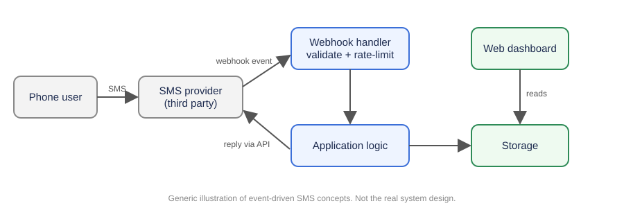

# SMS Messaging Platform — Software Engineering Portfolio

**Founder and software developer** of a commercial web application for two-way SMS conversations between a business and the people texting it.

> **The commercial source code is private.** This repository is a portfolio summary only. It contains no application code, configuration, data, or internal design details.

*Generic illustration of the concepts involved, not the real system design.*

## Overview

Incoming text messages arrive from a third-party telephony provider as webhook events. The application processes each event, generates and sends a reply through the provider's API, and records the conversation in a web dashboard for the business owner.

The project is in **active development**. It is not presented as a launched product, and no usage, customer, or revenue figures are claimed.

## Highlights

- **Backend and API integration:** server-side route handlers, an external REST messaging API, authentication and account flows
- **Webhooks and event-driven processing:** inbound events trigger a receive → process → reply → record pipeline
- **Reliability:** input validation, per-sender usage limits, fallbacks, and SMS length and encoding checks right before sending
- **Testing and debugging:** unit tests with the Node.js test runner, and local webhook testing through a tunnel
- **Frontend:** authenticated dashboard with live-updating conversation views

## Technology (general)

| Area | Tools |
|---|---|
| Language | TypeScript |
| Web framework | Next.js (App Router), React |
| Styling | Tailwind CSS |
| Authentication | Auth.js (NextAuth) |
| Testing | Node.js built-in test runner |
| Tooling | Git, ESLint, npm |
| External services | A third-party SMS/telephony API, a hosted database and file storage, a transactional email service |

Specific vendors, configuration, and infrastructure are intentionally not listed.

## Documentation

| Document | Contents |
|---|---|
| [docs/skills.md](docs/skills.md) | Engineering skills demonstrated, in detail |
| [docs/engineering-challenges.md](docs/engineering-challenges.md) | Technical challenges, described at a high level |
| [docs/architecture.md](docs/architecture.md) | Generic concepts diagram (not the real design) |

## Status

| Area | Status |
|---|---|
| Web dashboard, authentication, account flows | Implemented |
| Inbound SMS webhook and automated replies | Implemented, in development testing |
| Automated tests for core logic | Implemented (unit level) |
| Public launch | Not yet; ongoing development |

## My role

- Founder and software developer
- Designed and built the web application, backend request handling, and integrations
- Wrote the automated tests and handled debugging, deployment fixes, and version control

## Source code

The application is a private commercial project, so its source code, data, and configuration are not published. I am happy to discuss the engineering in more detail in an interview.

---
© 2026 Ben Katz. All rights reserved. See [LICENSE](LICENSE).
