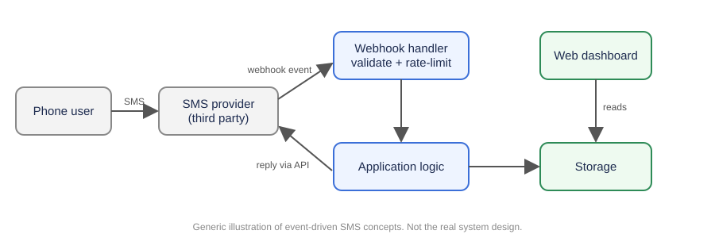
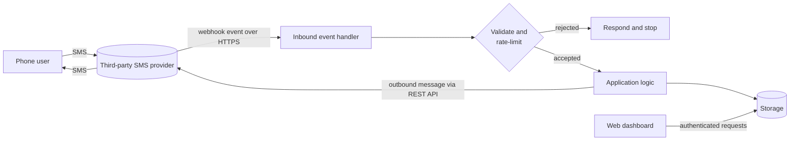

# Generic architecture concepts

This is a **textbook-level illustration** of the concepts the project works with: event-driven processing of inbound messages from an external API. It is intentionally generic. It is **not** the real system design, and it omits all internal components, data models, workflows, and vendors.

## Concepts illustrated

| Concept | What it means in general |
|---|---|
| Webhook | The provider calls the application over HTTP when an event happens, instead of the application polling for it. |
| Event-driven processing | Work starts when an event arrives, not when a user clicks something. |
| Validation and rate limiting | Every inbound event is checked before any work is done, and repeated traffic from one sender is limited. |
| External API integration | Outgoing messages are sent by calling the provider's API, and failures are handled explicitly. |
| Separation of concerns | Network I/O is kept apart from logic so the logic can be unit-tested. |
| Authenticated dashboard | A separate web interface reads stored results for the account owner. |
